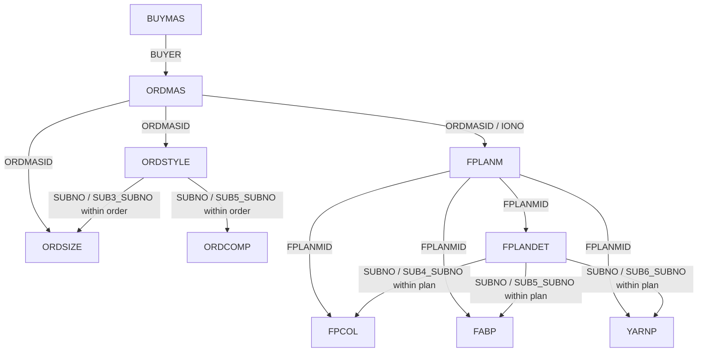

# POPPYS ERP recording — full timeline and automation analysis

Analysis date: 17 October 2026 (Asia/Calcutta).

**Main finding:** The recording shows buyer/CAD/BOM reference review, followed by an actual Axpert **Sample Order Entry → Fabric Planning → colour → grammage → yarn → save** demonstration. The reference NEXT order and the live BABY SHOP sample are separate examples. A correct automation must preserve pack/piece conversion, component and colour hierarchy, size allocations, sample fabric allowance, and yarn percentages.

## Evidence and scope

- Source: `GOPAL-PC (83082217) - UltraViewer 2026-10-09 22-24-07.mp4`.
- Duration: **43:46.512**, resolution **1376 × 776**, 63,094 reported video frames.
- Reviewed the complete timeline using **526 images at five-second intervals**, a searchable local OCR index, **234 scene-change images from a full video decode**, and closer samples around important transitions. Key figures, warnings and save messages were visually checked at source resolution. This is a visual workflow analysis, not a frame-by-frame action transcript; brief events can escape sampling or scene detection.
- The complete audio track is digital silence: FFmpeg reports both mean and maximum volume of **−91.0 dB**. There is no usable narration to transcribe or translate.
- Sources also include the supplied master-prompt document and the supplied GARMENT inventory dated 15 October 2026. Instructions inside the master prompt are treated as reference requirements, **not as authorization to build the application during this analysis task**.
- A screen label, a catalog column, a declared key reported by the catalog, and a live database verification are different evidence types. **No live Oracle discovery, database writes, or application implementation were performed for this analysis.**
- “Saved” below means Axpert displayed a success message in the recording. It does not establish the actual SQL executed, affected row counts, generated IDs, trigger effects, or an independent database read-back.

## 1. Complete timeline

Times are recording offsets, not the Windows clock visible inside the recording. Boundaries are approximate; linked frames show individual observations.

| Recording time | Visible activity | Meaning for automation |
|---|---|---|
| 00:00–00:10 | Email describing an AI merchandising pilot, with buyer Excel, CAD PDF, manual merchandising Excel, Axpert screen JPGs and program-summary PDFs attached | Inputs come from several documents; the email describes intent, not completed automation |
| 00:10–03:51 | CAD PDF opened, rotated and inspected; calculator appears around 03:00 | Scanned/rotated CAD input needs orientation handling and version control; calculator results alone do not prove a formula |
| 04:14–05:47 | Buyer contract-confirmation spreadsheet: N44441 and N44442, contracts, delivery dates, horizontal size columns | Repeated order blocks and wide size matrices need separate parsing |
| 05:58–06:32 | Existing Axpert Order Entry screenshot with size popup | Reference NEXT order: 500 ordered packs, 515 production packs, 3% excess displayed |
| 06:36–07:30 | Existing Fabric Planning screenshot, shown twice | Order `PK/26-27/E/1372`, plan `FPL/26/2808`, body and binding portions |
| 07:33–07:46 | Fabric-planning colour popup in screenshot | Three colour/component variants, each with 515 production units |
| 07:55–07:59 | Order-entry component popup in screenshot | A three-piece pack contains three BODYSUIT component rows, one piece each |
| 08:01–08:05 | Reference grammage popup in screenshot | 1,545 planned pieces; body 59 g; total body weight 91.155 kg |
| 08:15–09:29 | Manual NEXT BOM Excel: header, pack/piece totals, component matrix, repeated summary | Workbook contains detail and summary views of the same quantities; avoid counting both |
| 09:30–09:32 | Six fabric-requirement rows | Three garments × body/binding, with different base/AOP colour meanings |
| 09:33–09:38 | Prongs, care labels and twill-tape sections scrolled | Accessories use material-specific multipliers, units and rejection allowances |
| 09:40–14:35 | Email review and forwarding/composition activity | Coordination interval; no additional order-entry completion established |
| 14:35–15:08 | Axpert login and welcome dashboard | Existing desktop ERP; a brief loading/not-responding state is visible |
| 15:08–17:10 | Live Sample Order Entry header filled | BABY SHOP, style 0008, sample order `PK/26-27/S/1320` |
| Around 17:00 | Missing detail-row Style No warning | Required fields must be checked at row level, not just header level |
| 17:10–18:14 | Detail row completed; style master briefly opened around 17:35; shipping date and combo chosen | Master lookup, PO `TEST`, ship date 14/10/2026, ABSTRACT BLUE |
| 18:14–19:35 | Size popup: initially 0, then 5; later corrected to 10 | Size total must reconcile with the order line |
| 19:45–20:10 | Quantity warnings/errors; header PO quantity visibly 0, later changed to 10 | The error cannot be attributed only to the earlier 5-piece size allocation; header/detail totals also disagree |
| **20:15** | **“Sample Order Entry saved.”** | Explicit UI save confirmation; bottom order/production totals are both 10 |
| 20:42–21:18 | Fabric Planning opened; saved sample order searched and selected | The planning screen retrieves the order reference, buyer, style and PO |
| 21:18–21:28 | Colour popup; ABSTRACT BLUE; **Sample Kgs entered as 10** | Additional sample fabric is separate from garment-piece consumption |
| 21:32–22:16 | Fabric master selected; portion BODY, GSM 180, SOLID, CAD Yes | Reference resolution precedes size-wise material planning |
| 22:16–24:00 | Grammage popup; missing KDIA warning; 56 g, KDIA 32 and FDIA 32 entered | 10 planned pieces × 56 g = 0.560 kg |
| 24:00–25:25 | Fabric quantity becomes 10.560; yarn-percentage warning; yarn rows entered and adjusted | Final 90% + 10% allocation gives 9.504 + 1.056 kg |
| **25:35** | **“Fabric Planning Entry saved.”** | Second explicit UI save confirmation |
| 25:40–26:30 | New blank plan `FPL/26/3016`; navigation back to Sample Order Entry | An allocated next number alone does not mean another record was saved |
| 26:30–27:07 | Blank next sample-order form, then return to email | No second completed sample order shown |
| 27:07–32:14 | Manual BOM revisited; brief Toad editor around **27:35.5**; switches between windows | SQL text is visible, but Toad status says **ORA-01012: not logged on**; this is not a successful database verification |
| 32:15–33:03 | Brief browser/login page and reference screenshot/CAD previews | Reference review, not a new ERP transaction |
| 33:04–40:30 | Mostly blank next Sample Order Entry, number `PK/26-27/S/1321` | No populated second order or second save confirmation observed |
| 40:35–43:10 | Outlook and an unrelated administrative email; remote-viewer connection | Outside the merchandising transaction being demonstrated |
| 43:11–43:46 | “Plan Smart - Garments : Vertical Board” browser screen | Separate unit/month planning heatmap; formula and ERP integration are not demonstrated |

## 2. NEXT bulk-order reference — what the numbers mean

These are reference images/workbooks displayed in the recording, not the order typed during the live demonstration.

| Item | Observed value |
|---|---|
| Buyer | NEXT / NEXT UK, depending on source |
| Style/item | `N44441` |
| Description | `SP HD 3 G SS MIN BODYSUIT` in the manual BOM/reference ERP |
| ERP order | `PK/26-27/E/1372` |
| Fabric plan | `FPL/26/2808`, dated 22/09/2026 |
| Contract | `VG8439288-1` in manual BOM; buyer contract screen separately has contract number and delivery number |
| Packing | `3PC PACK`, three component pieces per pack |
| Ordered | **500 packs = 1,500 pieces** |
| Production | **515 packs = 1,545 pieces** |
| Excess | 3.00% shown in the size popup |
| Component variants | WHITE BASE PINK FLORAL AOP; PINK DOGWOOD BASE HEART AOP (AS SWATCH); PINK DOGWOOD 12-1706TCX BASE MULTI HEART AOP (DISC) |

The component popup shows three BODYSUIT rows, each with “No of Pcs” 1. The manual BOM repeats the size allocation for each component. **The ten size quantities below sum to 500 packs, not 1,500 packs.**

| Size as displayed | Ordered packs | Production packs shown | Ordered pieces across 3 components |
|---|---:|---:|---:|
| 5 lb | 8 | 8 | 24 |
| First Size | 19 | 20 | 57 |
| Up To 1M | 52 | 54 | 156 |
| Up To 3M | 125 | 129 | 375 |
| 3–6M | 139 | 143 | 417 |
| 6–9M | 75 | 77 | 225 |
| 9–12M | 41 | 42 | 123 |
| 12–18M | 19 | 20 | 57 |
| 1.5–2Y | 14 | 14 | 42 |
| 2–3Y | 8 | 8 | 24 |
| **Total** | **500** | **515** | **1,500** |

The production values are consistent with rounding 3% extra at each size in this example. That does **not** establish the ERP's general rounding method or how it resolves half values. Preserve this example as a reconciliation fixture and verify the real rule separately.

### Fabric reconciliation

The manual BOM has six source rows: BODY and BINDING for each of three garments. The reference ERP represents two portion rows and separates colours in child popups.

| Portion | Manual fabric specification | GSM | Consumption | Requirement per 500-piece component |
|---|---|---:|---:|---:|
| BODY | Interlock, 100% Cotton–Bio wash, count 42's, 66 Dia | 200 | 59 g/piece | 29.500 kg |
| BINDING | 1×1 Rib, 100% Cotton–Bio wash, count 32's, 30 DIA/TUB | 180 | 26 g/piece | 13.000 kg |

The ERP fabric master wording differs: body includes `42 S INTERLOCK-AOP 100% COTTON`; binding includes `34 S 1X1 RIB 100% BCI COTTON`. **The manual 32's binding versus ERP 34 S binding is a source discrepancy requiring confirmation.** Do not replace one automatically because the descriptions are similar.

Reconciliation using the displayed 1,545 production pieces:

```text
Body:     1,545 × 59 / 1,000 =  91.155 kg
Binding:  1,545 × 26 / 1,000 =  40.170 kg
Total:                       131.325 kg
```

**131.325 kg matches the reference ERP Total Kgs.** The order-only total is `1,500 × 85 / 1,000 = 127.500 kg`. Keep order consumption and production consumption separate.

Base colour and printed/AOP colour are distinct. For example, WHITE can be the base while WHITE BASE PINK FLORAL AOP is the finished variant. The colour popup also carries combo quantity and Sample Kgs. A flat colour string loses this information.

### CAD is a separate versioned input

The CAD page for N44441 displays a **revised quantity of 750**, a prior pattern/add-quantity note of 340, and dates printed as 26-05-25. Its size row is `0, 0, 0, 265, 199, 110, 66, 44, 44, 22`, totalling 750. Handwritten consumption is body 59 g and binding 26 g.

This differs from the 500-pack buyer/BOM example and its date labels. The page alone does not establish whether 750 refers to packs, pieces, a revision, or another production scope. Do not force it into the 500-pack order or distribute it automatically. The manual season AW-25 also coexists with 2026/2027 dates; preserve and flag these labels instead of silently correcting them.

### Accessories are another calculation domain

- The manual workbook shows **15-L PRONGS**, additional PRONGS sections, **CARE LABEL**, and **TWILL TAPE 5MM**. These are spreadsheet references; the live demonstration does not save an accessories plan.
- Prongs use a multiplier of 4 for the first four size rows and 6 for later rows. The displayed base requirement totals **2,592**, with rejection factor **1.03** and total **2,670**.
- Care labels use multiplier 3 across the 500-pack size allocation: **1,500** base labels and **1,545** after the displayed 1.03 factor.
- Twill tape introduces a length unit; its complete row values are not established here.
- Displayed rounded accessory rows may not sum to the displayed total. For example, the visible prong rejection rows sum to 2,669 while the total displays 2,670; `2,592 × 1.03 = 2,669.76`. This is consistent with unrounded underlying cells plus number formatting. Obtain the workbook's raw values, formulas and formats before implementing rounding.

## 3. Live BABY SHOP sample order — final observed state

| Screen field | Observed value |
|---|---|
| Exporter | POPPYS KNITWEAR PRIVATE LIMITED |
| Against | ENQUIRY |
| Buyer | BABY SHOP |
| Department | DIRECT |
| Style | **`0008`** — preserve leading zeroes in the business reference |
| Description | `1 FAM FTD P DAD SLEEPSUIT` |
| OC No | **`PK/26-27/S/1320`** |
| Separate “Order No” lookup | Blank in the saved sample screen |
| Order confirmation date | 09/10/2026, i.e. 9 October 2026 |
| PO quantity / UOM at successful save | **10 / PCS** |
| Packing / components | SINGLE / 1 |
| Season | 2027Q1 |
| Merch | ANANDAKUMAR-SAMPLE |
| Fabric Head | BALAJI.M |
| Production Unit | AADHAVAN TEX |
| Merch Manager | DHINAKARAN |
| Sample Type | DEVELOPMENT SAMPLE |
| Gender | Boys |
| Size Group | 0-3M – 0-3M |
| Detail Style / PO | 0008 / TEST |
| Detail Ship Date | **14/10/2026**; earlier calendar selection displayed 09/10/2026 |
| Detail Combo | ABSTRACT BLUE |
| Detail Qty / Combo Qty | 10 / 10 |
| Size popup final row | Size 0-3M; Ratio/Qty 10; excess 0%; extra pieces 0; order 10; production 10 |
| Footer totals | Order 10; production 10; invoiced 0; dispatched 0; Shipment Done NO |
| Financial totals | Forex 0.00000 and INR 0.00000 in this sample |
| Save evidence | **20:15**, explicit “Sample Order Entry saved.” popup |

The 5-piece size popup in the user-supplied screenshot is an **intermediate state**. At 19:35 the video shows it changed to 10. Around 19:45–20:00 the header PO quantity remains 0 while line/footer quantities are 10; the header becomes 10 before the successful save. Validate all levels together instead of treating the first screenshot as the final business record.

## 4. Live fabric, colour, grammage and yarn plan

| Area | Observed value |
|---|---|
| Plan | **FPL/26/3015**, dated 09/10/2026 |
| Linked order / buyer / style / PO | PK/26-27/S/1320 / BABY SHOP / 0008 / TEST |
| Copy Plan | NO |
| Portion | BODY |
| Collar/Twill / Main Part / Folding | 0.00 / YES / NO |
| Unit | KGS |
| Fabric | `16 S SINGLE JERSEY 100% BCI COTTON` |
| GSM / design / CAD | 180 / SOLID / Yes |
| Colour popup | Combo ABSTRACT BLUE; combo production quantity 10; base and Base/AOP colour ABSTRACT BLUE |
| Sample Kgs | **10**, visibly entered around 21:26 |
| Grammage row | 0-3M; order 10; production 10; plan 10; **56.0000 g**; total **0.560 kg** |
| KDIA / FDIA / Ex.Collar | 32 / 32 / 0.00 |
| Final fabric quantity | **10.560 kg** |
| Yarn row 1 | `40 S BCI COTTON 100%`, GREIGE, **90%**, **9.504 kg** |
| Yarn row 2 | `140/70 DENIER NYLON LYCRA`, GREIGE, **10%**, **1.056 kg** |
| Yarn flags | Y/D No; Twisting No; LF No in final popup |
| Final yarn quantity | **10.560 kg** after closing the completed yarn popup |
| Reference indicators | Repeat planned gram 318; repeat actual gram 292; DEVIATION LOW |
| Other indicators | No of special requests 0; closed-order stock 3.800 |
| Save evidence | **25:35**, explicit “Fabric Planning Entry saved.” popup |

The arithmetic reconciles:

```text
Garment consumption:     10 pieces × 56 g / 1,000 = 0.560 kg
Additional Sample Kgs:                           + 10.000 kg
Displayed fabric requirement:                     10.560 kg
Yarn split: 10.560 × 90% = 9.504; × 10% = 1.056 kg
```

The Sample Kgs field explains the apparently large material quantity. It is **not** an unexplained `10 × 56 g = 10.560 kg` calculation. The recording supports this example; the universal formula, allowances and treatment across several colours/portions still need ERP-rule verification.

Two discrepancies require explicit review before production automation:

1. The selected fabric says **100% BCI cotton**, but the final yarn breakdown contains **10% nylon lycra**. The demonstration may use arbitrary sample values. Preserve the observation and flag the composition mismatch; do not adopt it as a valid recipe.
2. The planning header shows **Prod Quantity 0** while **Production Quantity (Pcs) 10**, and the grammage popup also shows production 10. These are distinct displayed fields. Their exact semantics and database mappings are not proven by similar names.

The **3.800 closed-order stock** is displayed, but no stock-allocation calculation or Stock Update action is established. Do not subtract 3.800 from the requirement automatically. Repeat-style 318/292 values also should not replace the current 56 g input or be used to infer a deviation threshold.

## 5. Validation behaviour actually demonstrated

| Evidence | Observation | Requirement for an automation |
|---|---|---|
| Around 17:00 | Detail Style No Row 1 cannot be left empty | Validate every required detail field even when the header has a style |
| 18:35–19:35 | Size quantity initially 5, later 10 | Reconcile size quantity to the applicable style/PO/combo line |
| 19:45–20:00 | “Total Order Qty/Order Qty Not Completed, Kindly Check the Qty” warnings/error | Reconcile header, line, combo, size and footer totals, including UOM conversion |
| 22:25 | KDIA Parent Row 1 / Popgrid Row 1 cannot be left empty | Nested popup validation is required; FDIA is also starred on the screen |
| 24:10 | “TOTAL YARN PER TO BE 100%” | Enforce 100% within the relevant fabric-plan portion; then recompute quantities |
| 24:40–25:20 | One yarn starts at 100%, becomes 90%, another row completes 10% | Revalidation must follow edits; intermediate states are not final approved plans |
| 20:15 and 25:35 | Separate save confirmations | Order save and planning save are distinct operations; their cross-screen atomicity is not established |

UI asterisks and popup validations are not equivalent to Oracle `NOT NULL` constraints. Business validation must be represented separately from structural database validation.

## 6. Database interpretation from the supplied catalog

The following table/column names **exist in the supplied inventory**. The corresponding screen mappings are **candidates**, not live-verified mappings. A field name match alone is insufficient permission to insert a value.

### Order candidates

| Screen meaning | Candidate catalog location | Evidence / unresolved point |
|---|---|---|
| Buyer name | `BUYMAS.BUYERNAME`; order uses `ORDMAS.BUYER` → `BUYMAS.BUYMASID` | Catalog reports the master relationship; resolve ID, not a text name into NUMBER |
| OC business reference | `ORDMAS.DOCID` | Strong contextual candidate; `ORDMAS.ORDNO` is NUMBER and is not interchangeable with the displayed OC string |
| Style business reference | `STYLENUM.STYLENUMBER`; `ORDMAS.STYLENO` and `ORDSTYLE.STNO` are numeric references | Preserve `0008` as text during parsing; resolve exact master ID |
| Garment description | `STYLEMAS.SDESC`; `ORDMAS.STYLEDESC` / `ORDSTYLE.STYLENAME` | Header/detail semantics need screen metadata |
| Department / gender / against | `ORDMAS.DEPARTMENT`, `GENDER`, `OAGAINST` | Candidate label matches |
| Sample type | `ORDMAS.SAMPLETYPE` or `SAMTYPE` | **Ambiguous:** both exist; do not guess |
| Order confirmation date | Candidates include `ORDMAS.ODATE`, `BODATE`, `INPUTDT` | **Ambiguous:** screen-definition evidence needed |
| Header quantity | Candidates include `ORDMAS.OQTY`, `BOQTY`, `TOCQTY`, `TORDQTY` | Different quantity domains; confirm meaning before mapping |
| Packing / components | `ORDMAS.COMPTYPE`, `NOCOMP`; detail also has `ORDSTYLE.PUOM`, `NOFPCS`, `TNOCOMP` | SINGLE versus 3PC PACK requires explicit conversion semantics |
| PO / ship date / combo | `ORDSTYLE.PONUM`, `SHIPDT`, `COMBO` | COMBO relationship to COLORMAS is reported as a declared key in catalog |
| Detail quantities | `ORDSTYLE.ORDQTY`, `COMBOQTY`, `PRODQTY` | All exist; prove pack/piece/production roles separately |
| Size allocation | `ORDSIZE.GSIZE`, `RATIO`, `EXPER`, `EXPCS`, `RQTY`, `PQTY` | `GSIZE` → `SIZE_MAS.SIZE_MASID`; order/production roles are strong candidates |
| Component popup | `ORDCOMP` | Catalog reports order-screen grouping and SUBNO relationships; exact field mapping pending |

**ORDERENTRY is a real table in the inventory, but its name does not prove it is the only or primary write target for the Order Entry screen.** The order-screen grouping includes ORDMAS, ORDSTYLE, ORDSIZE and other children. Determine whether ORDERENTRY is maintained by Axpert logic, a trigger, a procedure, or direct writes before using it as an insert target.

### Fabric-plan candidates

| Screen / popup | Candidate tables and columns | Status |
|---|---|---|
| Plan header | `FPLANM.FPLANMID`, `DOCID`, `DOCDATE`, `BUYER`, `IONO`, `STYLENO`, `BONO` | Columns present; catalog reports `IONO` → `ORDMAS.ORDMASID` including declared-key evidence |
| Header quantity domains | `FPLANM.ORDERQTY`, `PRODQTY`, `BOQTY`, `BOPQTY` | Screen-to-column correspondence requires verification |
| Repeat/style indicators | `FPLANM.PLGRM`, `ACTGRM`, `PLFILL`; stock/request indicators `CLSSTK`, `SPLCNT` | Candidate label matches, not proven formulas |
| Portion row | `FPLANDET.PORTION`, `MP`, `UOM`, `FABRIC`, `STNO`, `STYLEDESC`, `FGSM`, `GG`, `LL`, `DESIGN`, `FINFAB`, `SPLPROCESS` | Catalog contains these columns and several master joins |
| CAD/Yarn switches | `FPLANDET.GRMYES`, `YARNYES` | Candidate mappings only |
| Colour popup | `FPCOL.GCOMBO`, `PCOL`, `AOPCOL`, `COMBOPQTY`, `SAMKGS` | Preserves combo/base/AOP/sample allowance distinction |
| Grammage popup | `FABP.SIZES`, `SQTY`, `PQTY`, `PROQTY`, `CADWT`, `TOTWT`, `KDIA`, `FDIA`, `ALLOW` | All exist; CADWT is a strong gram-input candidate, but exact quantity/weight roles require Axpert metadata |
| Yarn popup | `YARNP.COUNTS`, `COLOR`, `PER`, `KGS`, `DYE`, `TW`, `LF`, `TWCOUNTS`, `TWCOLOR`, `TWISTPER` | Master joins to COUNTMAS/COLORMAS are catalog-supported |

The provided master prompt describes a **19-table local demo subset**. Its list does not include FPLANM, FPLANDET, FPCOL, FABP or YARNP. Therefore that stated subset cannot be assumed to cover this complete planning workflow. Their existence in the original client inventory does not prove they exist in local GARMENT_DEMO. Discover and approve any extension separately; do not create tables from names alone.

### Catalog-supported relationship shape

This diagram shows structural relationships reported by the supplied catalog, not proven cardinalities or a live database schema.



- FPLANM ↔ FPLANDET is supported by report joins and “saved together” evidence.
- FPLANDET ↔ FABP/FPCOL/YARNP uses different SUBNO child fields. **Scope these relationships by their parent plan**, and validate uniqueness before deciding join keys; joining on SUBNO alone can mix unrelated plans.
- “Saved together” does not prove a foreign key. The inventory reports declared-key evidence on selected master relationships, including FPLANM→ORDMAS, FPLANDET→FABMAS/PORTIONMAS/STYLEMAS, YARNP→COUNTMAS/COLORMAS and FPCOL.PCOL→COLORMAS.
- Master values such as style, size, fabric, colour, yarn count, portion and UOM must be resolved to their actual IDs. The business name is not the numeric key.

### Concrete catalog-quality issues

The selected catalog links include endpoints absent from the same tables' column listings. Examples are `FABMAS.PROMID`, `COUNTMAS.PROMID`, `BUYMAS.EXPORTMASID`, `ORDMAS.CPRODUNIT`, `SIZE_MAS.PARTYMASID`, and several COLORMAS references such as PARTYID and SIZE_MASID.

These may reflect stale or incorrectly attributed report joins. They demonstrate why a report-join inventory cannot be treated as executable DDL or an automatically approved relationship registry. Compare every proposed endpoint with live dictionary metadata and validate the report SQL itself.

The brief Toad screen at 27:35.5 shows SQL text joining order/style/fabric/colour/portion masters and movement tables. Its visible **ORA-01012: not logged on** status and lack of result rows do not verify those SQL statements or the saved sample. The historical connection title is not proof of a currently active connection.

## 7. Automation design implied by the recording

This is an implementation interpretation, not functionality demonstrated by the video.

```text
Buyer contract Excel + merchandising BOM + versioned CAD
    → extract raw values, formulas, formats and source locations
    → normalize orders / PO lines / pack components / colours / sizes
    → resolve approved ERP masters
    → calculate pack-piece, production, fabric and accessory requirements
    → reconcile discrepancies and nested totals
    → show source-to-target mapping and exact proposed changes
    → authorized review and approval
    → save order using verified ERP/database rules
    → save linked fabric/colour/grammage/yarn plan
    → read back and reconcile actual records
```

Suggested information hierarchy:

```text
Order header
  Style / PO / ship-date / pack-combo line
    Component variants (pieces per pack, colour/design)
    Size allocation (ordered and production quantities)
  Fabric plan
    Portion + fabric specification
      Colour/combo allocation and sample allowance
      Size-wise grams, diameters and material weight
      Yarn count/colour/percentage/weight rows
  Accessory plan (separate downstream scope)
```

Practical requirements:

1. Use original spreadsheet parsing for raw cells and formulas. OCR of the video is evidence for analysis, not a production ingestion method for available Excel files.
2. Preserve blank versus zero, display labels versus IDs, pack versus piece quantities, order versus production quantities, and grams versus kilograms.
3. Keep a source/version identity for buyer contracts, BOM and CAD. A newer-looking quantity must not silently replace another source.
4. Distinguish repeated summaries from independent detail rows. The manual workbook visibly repeats the component matrix and exposes formulas such as `F27 = F24 + F25 + F26`.
5. Group fabric source rows using style, portion, fabric specification and relevant process attributes, retaining separate colour children. Do not flatten six source rows into a single total.
6. Treat additional Sample Kgs as an explicit, reviewable material allowance. Show the garment consumption and allowance separately.
7. Validate yarn percentages and composition against the approved fabric specification, as well as checking numeric totals.
8. Use decimal arithmetic and explicitly approved rounding rules. Formatting a cell to an integer is not the same as storing an integer.
9. Generate internal keys/document numbers through the verified ERP mechanism. Blank next forms display new numbers without proving a save; do not derive numbering by parsing the last screenshot or using MAX(ID)+1.
10. Determine whether a supported Axpert integration/API exists and what screen logic it executes. Direct database writes must reproduce verified validation, numbering, derived data and parent-child relationships; UI labels alone are insufficient.
11. Make the proposed order and plan operations individually reviewable and retry-safe. The recording demonstrates two separate saves; decide whether the new integration can support one atomic logical operation or must track recoverable stages.
12. Verify committed results by business reference and primary keys. A success toast alone is insufficient for the new application's audit trail.

## 8. Acceptance examples derived from observed evidence

These are future acceptance cases, **not tests executed against an application**.

| Case | Expected verification |
|---|---|
| NEXT three-piece pack | 500 packs → 1,500 ordered pieces; preserve three component variants |
| NEXT production allocation | Displayed size production quantities sum to 515 packs and 1,545 pieces |
| NEXT material consumption | Body 91.155 + binding 40.170 = total 131.325 kg |
| Repeated Excel summary | Parsing both visible sections does not double the order |
| CAD mismatch | 750 versus 500 is surfaced with source/version/UOM ambiguity |
| Leading-zero style | `0008` remains distinct text until an exact master match is resolved |
| Sample quantities | Header 0 or size total 5 versus line 10 blocks approval; corrected final 10 reconciles |
| Required nested fields | Missing detail Style No or required KDIA/FDIA prevents completion |
| Sample material allowance | 10 × 56 g = 0.560 kg; plus 10.000 Sample Kgs = 10.560 kg |
| Yarn allocation | 90% + 10% = 100%; weights 9.504 + 1.056 = 10.560 kg |
| Composition mismatch | 100% cotton fabric versus 10% nylon/lycra yarn is flagged for review |
| Accessory precision | Raw formulas and formats reconcile totals without assuming displayed rounded rows are exact |
| Existing stock | 3.800 stock is displayed but never deducted without an approved allocation rule |
| Duplicate submit / failure | No duplicate order/plan; retry and rollback/recovery behaviour are verified |
| Post-save read-back | Oracle row values, keys, quantity domains and relationships agree with the approved plan |

## 9. Outstanding decisions before implementation

- Which buyer/BOM/CAD version and quantity scope wins when the inputs disagree?
- Are order-level confirmation date, entry date and buyer order date different in this Axpert transaction?
- Which exact columns back header/line pack quantities, piece quantities and production quantities?
- How are `ORDMAS`, `ORDSTYLE`, `ORDSIZE`, `ORDCOMP` and `ORDERENTRY` populated by the current screen?
- Which triggers, sequences, packages, Axpert expressions and after-save procedures maintain derived rows and planning requirements?
- Which local demo planning tables and constraints actually exist, as opposed to the historical full-client catalog?
- What are the rounding rules for production, accessories, weight and percentage residuals?
- How is Sample Kgs applied when several colours, portions or fabrics share a plan?
- Are KDIA/FDIA values free text, numeric dimensions, or controlled master values? The catalog stores the FABP fields as VARCHAR2(20).
- Is the 10% nylon/lycra row intentional, and which fabric/count mismatch policy should apply?
- How does closed-order stock become an allocation, reservation or consumption? What exactly does Stock Update do?
- What defines repeat planned/actual gram and LOW deviation? The screenshots show different actual-gram values, including 72 and 81, in reference states.
- Are special requests, accessories planning, process sequence and the separate capacity board part of the first implementation phase? Their full workflows are not demonstrated.

These decisions are recorded for future implementation; they do not prevent completion of this video analysis.

## 10. Existing project context

The active `backend/db.py` describes a schema-agnostic payroll-oriented discovery layer with name/salary/department heuristics and a demo-data fallback. That is not evidence that the garment upload, order-entry, material planning or approval workflow already exists. The video-derived ERP semantics need a dedicated, verified business model before extending that code. Application/database behaviour was not changed during this analysis.

## 11. Evidence index and reusable files

| Evidence | Image |
|---|---|
| CAD revision/quantity | [00:25](video_analysis/frames/0025.jpg) |
| Buyer contract and sizes | [05:20](video_analysis/frames/0320.jpg) |
| NEXT size popup, 500/515 | [06:05](video_analysis/frames/0365.jpg) |
| NEXT fabric total 131.325 | [06:45](video_analysis/frames/0405.jpg) |
| NEXT three colour children | [07:35](video_analysis/frames/0455.jpg) |
| NEXT three-piece component popup | [07:55](video_analysis/frames/0475.jpg) |
| NEXT body grammage 91.155 | [08:05](video_analysis/frames/0485.jpg) |
| Manual header and pack/piece totals | [08:30](video_analysis/frames/0510.jpg) |
| Fabric rows | [09:30](video_analysis/frames/0570.jpg) |
| Prongs multiplier/rejection | [09:35](video_analysis/frames/0575.jpg) |
| Care labels | [09:37](video_analysis/frames/0577.jpg) |
| Initial size quantity 5 | [19:00](video_analysis/frames/1140.jpg) |
| Corrected size quantity 10 | [19:35](video_analysis/frames/1175.jpg) |
| Header/order mismatch error | [20:00](video_analysis/frames/1200.jpg) |
| Sample order saved | [20:15](video_analysis/frames/1215.jpg) |
| Sample Kgs 10 | [21:26](video_analysis/frames/1286.jpg) |
| Required KDIA warning | [22:25](video_analysis/frames/1345.jpg) |
| 56 g / 0.560 kg / diameters | [23:30](video_analysis/frames/1410.jpg) |
| Yarn 100% validation | [24:10](video_analysis/frames/1450.jpg) |
| Final yarn split | [25:20](video_analysis/frames/1520.jpg) |
| Fabric plan saved | [25:35](video_analysis/frames/1535.jpg) |
| Toad SQL text / not-logged-on status | [27:35.5](video_analysis/frames/toad_1655.5.jpg) |
| Blank next sample form | [33:05](video_analysis/frames/1985.jpg) |
| Separate planning board | [43:25](video_analysis/frames/2605.jpg) |

- [Machine-readable workflow facts](video_analysis/workflow_facts.json)
- [Video metadata and analysis method](video_analysis/video_metadata.json)
- [Relevant catalog columns and relationship evidence](video_analysis/catalog_evidence.json)
- [Relevant order/planning catalog excerpts](video_analysis/catalog_relevant_extract.txt)
- [Planning/master catalog excerpts](video_analysis/catalog_planning_masters_extract.txt)
- [OCR index — search aid, uncorrected text](video_analysis/ocr_index.txt)
- [Scene timestamps](video_analysis/scene_timestamps.json)
- [Whole-recording overview begins here](video_analysis/contact_sheets/overview_01.jpg); overview_01 through overview_11 cover the recording.
- [Scene-change review begins here](video_analysis/contact_sheets/scenes_01.jpg); scenes_01 through scenes_15 contain all 234 detected changes.

All processing for this analysis used local tools and the supplied files. No external AI transcription or document service was used.
