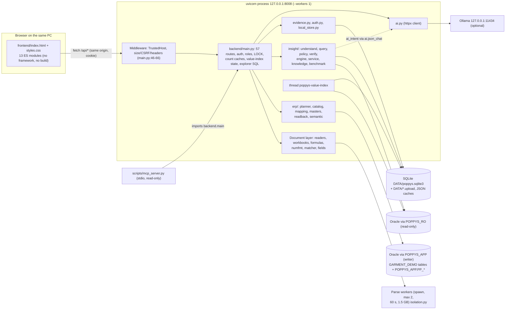

# Audit area 1 — Current application architecture

Repository: `/home/user/oracle`, branch `claude/fervent-babbage-jqo8r4`, commit `e811402`. Audit date 2026-10-18.
Documentation-only audit: no code, configuration, mapping or database was changed. `.env.poppys` and `data/` were not opened.

## Summary

- POPPYS AI is one Python 3.13 FastAPI process (`backend/main.py`, 1,595 lines, 57 API routes) bound to `127.0.0.1:8008`. It serves a framework-free, build-free vanilla-JS single page (13 ES modules, no vendored or CDN libraries) and keeps workspace state in one local SQLite file.
- Oracle access uses python-oracledb in thin mode with **a new connection per call and no pool**. A writer account (`POPPYS_APP`) does approval-bound inserts into `GARMENT_DEMO`. A separate read-only account (`POPPYS_RO`) serves Ask AI, the explorer and the value index, with a read-only transaction and call timeouts. The writer connection has **no call timeout**.
- Untrusted spreadsheet parsing runs in short-lived spawned worker processes with time and memory caps (`backend/isolation.py`). The optional local LLM (Ollama, `backend/ai.py`) only proposes layouts or intents, and every proposal is validated. Neither the LLM nor any proposal can write.
- Automated evidence: `pytest` gives 465 passed and 18 skipped (all skips need real Oracle, PowerShell or Windows). A runtime check on a demo server (port 8781, fake Oracle) confirmed the security headers, CSRF refusal, the 14 MB refusal, the host check and the upload, preview and approval gates.
- Everything Oracle-dependent beyond `setup.ps1`, `check_oracle.py` and `discover_schema.py` (run on the laptop on 2026-10-18, `docs/IMPLEMENTATION_STATUS.md:133-134`) is **NOT VERIFIED** against real Oracle.
- Main structural problems (§11): `main.py` holds every responsibility and one global lock; no connection pool and no writer timeout; `/openapi.json`, `/docs` and `/redoc` served without sign-in; the 14 MB limit relies on `Content-Length`; global `ValueError`/`KeyError` handlers can hide bugs; SQLite connections are never closed explicitly; every save stores a full draft copy, sheet cells included; `frontend/js/flow.js` is dead code that cannot load; `/readyz`, which the deploy scripts probe, does not exist.

## 0. Method and status labels

Evidence is given as `path:line`, as `path` plus a function name, or as a command and its result. The commands are listed in §12.
Status labels used in this document:
- **IMPLEMENTED**: a test or my runtime check exercises the code.
- **PARTIALLY IMPLEMENTED**: something is missing, and the text says what.
- **DOCUMENTED ONLY**: the feature appears only in `docs/`.
- **NOT IMPLEMENTED**: no code exists.
- **NOT VERIFIED**: code exists but nothing exercises it, or it can only be checked on the Windows laptop or against real Oracle.

## 1. Component diagram



## 2. Frontend

### 2.1 Framework, build and libraries
- **No framework and no build step.** The page loads one module, `<script type="module" src="/static/js/app.js">` (`frontend/index.html:195`). Every other file is a native ES module imported from it.
- **No vendored or CDN libraries.** `frontend/` contains only `index.html`, `styles.css` and `js/*.js` (`find frontend -type f`). A grep for `cdn|https?://` in `frontend/` finds only the SVG namespace. Fonts are system font stacks (`styles.css:12-13`) with no `@font-face` or `@import`. CI enforces "no resource from another site" (`scripts/check.sh:78`). Running `bash scripts/check.sh js` printed "OK: 13 modules parse and follow the content-security rules".
- The server's CSP is `script-src 'self'` with `style-src 'self' 'unsafe-inline'` (`backend/main.py:65`). The page uses no inline scripts.

### 2.2 Module map (all files)

| File | Lines | Responsibility | Imports |
|---|---|---|---|
| `index.html` | 197 | Static shell. Sidebar nav (`data-view` buttons), six `<section class="view">` screens, toasts container, drawer, native `<dialog>` modal and confirm, auth overlay, busy overlay | `app.js` |
| `styles.css` | 793 | All styling: CSS custom properties, 12 `@media` blocks (phone layout). No dark mode (no `prefers-color-scheme`) | — |
| `js/app.js` | 146 | App shell: session check, login/setup form, navigation `go()`, status lights polling, saved-orders list, global click delegation | util, api, workspace, explorer, admin, chat, dashboard |
| `js/api.js` | 33 | `api()` fetch wrapper (JSON, same-origin cookie, plain-language errors, 401 listeners), `id()` URL encoder, cached `orderFields()` | — |
| `js/util.js` | 81 | Shared `state` object, `$`/`$$`, `esc()` HTML escaping, formatters, `notify()` toasts, `busy()` overlay, `confirmDialog()`, `drawer()`, `modal()`, `formView()`, `csv()`, `timeAgo()` | — |
| `js/dashboard.js` | 46 | Overview: KPIs, work queue, recent saves from `/api/overview` and `/api/health` | util, api |
| `js/workspace.js` | 726 | New-order flow: upload, reading steps, Axpert-style review form, field-level issues, undo/redo, preview, approve, saved view | util, api, mapping, flowview |
| `js/mapping.js` | 479 | "Show us once" layout mapping: matcher/AI proposals, confidence, rejected fields, save as template | util, api |
| `js/chat.js` | 261 | Ask AI: question thread, answer table, check trace, linked-table graph, preview a table, add columns (re-run intent), feedback, CSV | util, api, graph, chart |
| `js/explorer.js` | 355 | Read-only database explorer: table list, filtered pages, keyset "Load more", record drawer with linked records, relationship map | util, api, graph |
| `js/admin.js` | 351 | Setup: write mapping, data dictionary, order fields, templates, accuracy benchmark, users, audit, settings | util, api |
| `js/graph.js` | 392 | Interactive SVG table flowchart: layered layout, master band, zoom/pan/fit, keyboard focus | util |
| `js/flowview.js` | 114 | "Where the data goes": a `graph.js` flowchart plus the selected table's rows (approval preview and saved read-back) | util, graph |
| `js/chart.js` | 54 | Answer charts as inline SVG strings (bars or line) from the returned rows only | util |
| `js/flow.js` | 108 | Older flowchart renderer. **Not imported anywhere. Its import cannot be resolved** (§2.8) | util |

### 2.3 Screens and "routing"
- There are six screens: `dashboard`, `workspace`, `history`, `chat`, `explorer` and `admin`. Each is a pre-rendered `<section id="view-…">` in `index.html` that is shown or hidden by `go()` (`app.js:51-61`).
- Each screen's loader runs on every visit (`loadDashboard`, `history`, `loadExplorer`, `loadAdmin`, `loadChat`, `ws.recent`).
- The hash is written with `history.replaceState` (`app.js:61-63`) and read once at start (`app.js:136-137`). No `hashchange` or `popstate` listener exists (grep), so the browser Back and Forward buttons do not move between screens, and no history entries are created.
- The workspace has internal stages (`stage-upload`, `-read`, `-review`, `-approve`, `-saved`, `index.html:63-100`). Setup has sub-sections (`data-admin`, `index.html:145-152`).

### 2.4 State management
- **One shared mutable object**, `state`, holds `user`, `permissions`, `draft`, `dirty`, `saved`, `health`, `tab`, `masters` and `busy` (`util.js:11-14`). It is imported by every screen module.
- Module-level variables hold per-screen state: `admin.js:5,88,145,282`, `chat.js:9,12` (`answers` Map), `explorer.js:7-10`, `mapping.js:20`, `workspace.js:20,447` (`undo` stack), `graph.js:34-35` (`views` WeakMap) and `api.js:29` (`fieldsCache`).
- There is no store library, no persistence (no `localStorage`) and no reactive binding. Screens re-render HTML strings into containers (73 `innerHTML` assignments across `frontend/js`). User values pass through `esc()` (`util.js:4`).

### 2.5 Reusable UI pieces

| Piece | Where | Notes |
|---|---|---|
| Tables | Template strings inside each screen (e.g. `app.js:70-74`) | No table component. CSV export via `util.csv()` |
| Forms | Static in `index.html` (auth, chat composer, explorer lookup) or rendered by screen modules | The read-only record "form view" is `util.formView()` |
| Dialogs | Native `<dialog id="modal">` and `<dialog id="confirm">` (`index.html:168-172`) via `util.modal()` and `confirmDialog()`; side drawer `util.drawer()` | — |
| Toasts | `util.notify()`: at most 4, auto-dismiss after 6 s (12 s for errors) | `aria-live="polite"` container |
| Busy indicator | `util.busy(message, action)`: full-page overlay, **single-flight** | A second action while busy returns without running and without any message (`util.js:26-27`). Global clicks are ignored while busy (`app.js:119`) |
| Flowcharts | `graph.renderGraph()` used by `flowview.js`, `chat.js`, `explorer.js` | SVG built in JS |
| Charts | `chart.answerChart()` | SVG strings, no library |

### 2.6 Charts and diagrams
- `chart.js` draws ranked horizontal bars, or a line for date dimensions. It draws nothing for a single row, negative values or no measure, and shows at most 20 bars or 60 points (`chart.js:6-13`).
- `graph.js` places nodes by longest-path rank from the roots, with an optional master band. It supports zoom, pan, fit and keyboard focus (`graph.js:46-80`). Its zoom maths are tested in Node by `tests/test_graph_view.py`, which passed.
- `flowview.js` combines a graph with the rows of the selected table.
- `flow.js` is dead (§2.8).

### 2.7 API client and authentication
- `api.js:11-25`: every request is a `fetch` with `credentials: 'same-origin'` and a JSON body.
- A network failure becomes a plain message ("server is not responding…"). A non-2xx response throws an `Error` carrying `status` and `data`; a 409 body includes `rejected` fields.
- **401 handling:** `api()` notifies listeners (`api.js:20`). `app.js:94` registers `onUnauthorized(() => session())`, which re-reads `/api/session` and shows the `#auth` overlay (`app.js:13`). The open draft stays in memory and is not cleared.
- `session()` itself uses a raw `fetch` (`app.js:11`).
- The session is an HttpOnly, `SameSite=Strict` cookie, `poppys_session` (`backend/main.py:130`). JavaScript never sees a token.
- Permission-gated UI is hidden with `[data-permission]` and `can()` (`app.js:134`). The server enforces permissions independently (§3.3).

### 2.8 Frontend findings
- **`flow.js` is dead and broken.** No file imports it (grep finds only its own definition, plus a mention in `docs/IMPLEMENTATION_STATUS.md:65` that lists it as implemented). It imports `record` from `./util.js` (`flow.js:4`), and `util.js` has no such export.
  - Linking the modules in Node: `flow` fails with "SyntaxError: The requested module './util.mjs' does not provide an export named 'record'". The other 12 modules link (`app` stops only at `document is not defined`).
  - CI misses this because `scripts/check.sh:68-73` runs `node --check`, which checks syntax only (`node --check` on `flow.js` passes).
- Test coverage of the frontend: only `graph.js` has an automated test. No Python test references `chart.js`, `flowview.js`, `workspace.js` or the other screens (grep). The browser checks claimed in `docs/IMPLEMENTATION_STATUS.md` were **NOT VERIFIED** by this audit.
- `app.js:138` polls `/api/health` every 30 s per open tab, and `/api/overview` too when the Overview is visible. Each health call opens two Oracle connections and calls Ollama (§5.3).

## 3. Backend

### 3.1 Process and runtime model
- The ASGI app is `backend.main:app`. `start.ps1:5` runs `python -m uvicorn backend.main:app --host 127.0.0.1 --port 8008` (one worker by default). The Windows service passes `--workers 1 --limit-concurrency 64 --no-access-log` (`deploy/windows/PoppysAI.xml:30`).
- Every route handler is a plain `def`. The only `async def`s are the lifespan, the middleware and the exception handlers (`grep -n "async def" backend/main.py`). FastAPI therefore runs handlers in AnyIO's worker-thread pool. The code does not configure that pool (grep for `total_tokens|thread_limiter|to_thread` finds nothing).
- **In-process state** that would not be shared across workers:
  - `LOCK` (`main.py:27`)
  - value-index state `_VALUES` (`main.py:941-944`)
  - count caches `_counts` and `_filter_counts` (`main.py:1305,1351`)
  - `_LEX` (`main.py:899`)
  - the knowledge memo (`insight/service.py:53`)
  - the verify memo (`insight/verify.py:25`)
  - the Ollama availability cache (`ai.py:134`)
  - the read-only-verified set (`oracle_store.py:36`)
- Startup (`main.py:38-43`): `store.init()`, `evidence.init()`, then `start_value_index()`.

### 3.2 Module map

**`backend/*.py`**

| Module | Lines | Responsibility | Key functions / classes |
|---|---|---|---|
| `main.py` | 1,595 | FastAPI app: middleware, exception mapping, sessions and roles, all 57 routes, draft workflow, value-index thread, count caches, explorer SQL, benchmark runner | `protect`, `_user`, `require`, `upload`, `preview`, `accept`, `query_sources`, `_build_values`, `table_counts`, `explorer_rows` |
| `config.py` | 17 | `ROOT` and `DATA` (`POPPYS_DATA_DIR`); loads `.env.poppys` once; `setting()`; enforces `OWNER == GARMENT_DEMO` | `setting` |
| `auth.py` | 122 | scrypt hashing (N=2^17), legacy PBKDF2 rehash, password rules, login throttling, session limits (30 min idle, 8 h absolute) | `hash_password`, `verify`, `problem`, `wait_seconds`, `failed` |
| `local_store.py` | 471 | SQLite workspace store: schema, additive migrations, drafts and revisions, audit, templates, fields, knowledge overrides, value index, examples, chat log, benchmark runs | `db`, `init`, `save`, `edited_orders`, `changes`, `audit` |
| `evidence.py` | 167 | Immutable, idempotent evidence ledger and open questions | `record`, `for_subject`, `ask`, `answer`, `verification_bundle` |
| `oracle_store.py` | 219 | Oracle connections (writer and read-only), session tagging, the approval-bound writer, history, live read-back | `connect`, `connect_readonly`, `write_privileges`, `commit`, `history`, `live_rows`, `read_result` |
| `db.py` | 4 | Re-export facade of `oracle_store` (no importer found by grep) | — |
| `readers.py` | 2,267 | Every spreadsheet format to one cell model; sniffing, size and zip caps; isolated parse | `sniff`, `read`, `read_ooxml`, `read_xls`, `read_csv`, `read_json`, `selfcheck` |
| `isolation.py` | 292 | Runs a parse in a spawned worker with a wall-clock limit, a memory cap (RLIMIT_AS / Windows Job Object), a CPU cap and a JSON-only result | `run`, `WorkerFailed`, `limit_self`, `_windows_job`, `diagnose` |
| `formulas.py` | 252 | Computes results of simple formulas a file saved without them (run inside the worker, `readers.py:827`) | `fill_missing` |
| `numfmt.py` | 107 | Narrow Excel number-format rendering so codes such as `0008` keep their zeros | `render`, `is_text_format` |
| `workbooks.py` | 1,290 | Cell model to business orders: templates, merch-BOM and buyer-contract detectors, flat tables, units, BOM | `parse`, `parse_sheets`, `apply_template`, `Grid`, `finish` |
| `matcher.py` | 658 | Deterministic, explainable field matcher and validator for unknown layouts; merges AI proposals | `suggest`, `check`, `merge`, `anchors` |
| `fields.py` | 158 | Canonical order fields, defaults plus admin aliases and required flags | `Fields`, `effective`, `clean_aliases` |
| `ai.py` | 146 | Local Ollama client: layout proposal, draft explanation, JSON chat for Ask AI, heuristic fallback | `status`, `suggest`, `assist`, `json_chat`, `available` |
| `insight_api.py` | 3 | Facade re-exporting `insight.service` | — |
| `mcp_server.py` | 285 | Read-only MCP server over stdio. Imports `backend.main` for its knowledge base and sources | `Server`, `serve`, `main` |

**`backend/erp/`**

| Module | Lines | Responsibility | Key items |
|---|---|---|---|
| `catalog.py` | 118 | What the planner may know: live dictionary (`OracleCatalog`) or committed snapshot (`SnapshotCatalog`, `live=False`). Masters are capped at 5,000 rows (`catalog.py:12`) | `OracleCatalog`, `SnapshotCatalog` |
| `mapping.py` | 72 | `config/oracle_mapping.json` registry (cached with `lru_cache`), validation, overrides | `effective`, `referenced_tables`, `fingerprint` |
| `planner.py` | 595 | Deterministic, hashable insert plan from reviewed orders. Never writes | `plan`, `Issues`, `digest`, `normalize` |
| `masters.py` | 69 | Matches file values to existing master rows (exact, fingerprint, similar) | `Index`, `fingerprint` |
| `readback.py` | 139 | Flowchart of planned rows (`planned`) and of saved rows read live from Oracle (`graph`) | `planned`, `graph` |
| `semantic.py` | 50 | Semantic model (entities, verified columns, joins) from the registry | `model` |

**`backend/insight/`**

| Module | Lines | Responsibility | Key items |
|---|---|---|---|
| `knowledge.py` | 214 | Knowledge catalog merging four layers: physical, registry, curated `config/semantic_catalog.json`, admin edits | `build`, `Knowledge` |
| `service.py` | 458 | Dictionary harvest and cache, knowledge memo, read-only executors, value index, uploads source, live finder | `harvest`, `knowledge`, `OracleExecutor`, `SqliteExecutor`, `refresh_values`, `live_finder` |
| `understand.py` | 562 | Question to intent: rules first, then `ai_intent()` fallback | `interpret`, `lexicon`, `ai_intent`, `schema_cards` |
| `query.py` | 403 | Intent to single bound SELECT; the only SQL author for questions | `compile_intent`, `Dialect`, `QueryError` |
| `policy.py` | 121 | Independent SQLGlot safety review of every read-only statement; fails closed | `check`, `review`, `UnsafeSQL` |
| `verify.py` | 144 | Join-uniqueness check and total cross-check | `joins`, `cross_check` |
| `engine.py` | 312 | Governed answer pipeline and rules-vs-AI comparison | `ask`, `run`, `pick`, `generalize` |
| `benchmark.py` | 163 | Golden-question accuracy benchmark | `load`, `run`, `compare` |

### 3.3 API surface
Roles and permissions are defined in `main.py:28-34`:
- viewer: `view`
- operator: view, upload, edit, preview
- approver: operator's permissions plus approve, audit
- admin: approver's permissions plus users, mapping, templates, settings

`authenticated` means any signed-in user. `require('view')` is equivalent, since every role has `view`. The route list below was produced by introspecting `app.routes` and matches the decorators at the lines shown.

| Group | Method and path (main.py line) | Permission |
|---|---|---|
| Session | GET `/api/session` (150), POST `/api/setup` (159, first run only, 409 after), POST `/api/login` (171), POST `/api/logout` (193) | none |
| Users | GET `/api/users` (212), POST `/api/users` (219), PATCH `/api/users/{username}` (230) | users |
| Status / settings | GET `/api/health` (255), GET `/api/masters` (277), GET `/api/settings` (286) | authenticated |
| | PUT `/api/settings` (296) | settings |
| Drafts | POST `/api/uploads` (351) | upload |
| | GET `/api/drafts` (379), GET `/api/drafts/{id}` (383) | authenticated (all users see all drafts) |
| | PUT `/api/drafts/{id}` (412), POST `/api/drafts/{id}/map` (481), POST `/api/drafts/{id}/suggest` (535) | edit |
| | POST `/api/drafts/{id}/preview` (568) | preview |
| | POST `/api/drafts/{id}/accept` (581) | approve |
| | POST `/api/drafts/{id}/assist` (1578) | authenticated |
| Overview / history | GET `/api/overview` (613), GET `/api/history` (637), GET `/api/history/{id}` (650), GET `/api/history/{id}/graph` (659) | authenticated |
| Mapping / evidence | GET `/api/mapping` (688), GET `/api/semantic-model` (720), GET `/api/evidence` (768), GET `/api/evidence/questions` (781), GET `/api/templates` (833), GET `/api/fields` (850) | authenticated |
| | POST `/api/evidence` (774), POST `/api/evidence/questions` (786), POST `/api/evidence/questions/{qid}/answer` (794), POST `/api/mapping/status` (811), PUT `/api/fields/{key}` (862) | mapping |
| | POST `/api/templates/{tid}/active` (886) | templates |
| | GET `/api/audit` (893) | audit |
| Knowledge | GET `/api/knowledge` (1047), GET `/api/knowledge/tables/{table}` (1058), GET `/api/knowledge/neighbours/{table}` (1064), GET `/api/knowledge/joins` (1075) | authenticated |
| | PUT `/api/knowledge/objects` (1092), POST `/api/knowledge/refresh` (1119) | mapping |
| Ask AI | POST `/api/chat/ask` (1173), POST `/api/chat/run` (1219), POST `/api/chat/preview` (1235), POST `/api/chat/{cid}/feedback` (1268) | view |
| | GET `/api/chat/history` (1280), GET `/api/chat/history/{cid}` (1284, owner or admin), GET `/api/chat/examples` (1292) | authenticated |
| | DELETE `/api/chat/examples/{eid}` (1296) | mapping |
| Benchmark | POST `/api/benchmark/run` (1196) | mapping |
| | GET `/api/benchmark` (1206) | view |
| Explorer | GET `/api/explorer/tables` (1388), GET `/api/explorer/tables/{table}` (1436), GET `/api/explorer/related/{table}/{pk}` (1519) | authenticated |
| Static | GET `/` (1592, `index.html`), mount `/static` (1595, the whole `frontend/` folder) | none |
| FastAPI defaults | GET `/openapi.json`, `/docs`, `/docs/oauth2-redirect`, `/redoc` | **none** (not disabled in `FastAPI(...)` at `main.py:45`) |

There are no other routers: grep for `APIRouter|include_router` finds nothing. Runtime check: `GET /openapi.json` without a cookie returned 200 (31,548 bytes, 52 paths). `/docs` returned 200 and references `cdn.jsdelivr.net` assets, which the CSP blocks, so the page is served but cannot render.

### 3.4 Middleware and request protection
- **Host check:** `TrustedHostMiddleware` allows `127.0.0.1`, `localhost` and `testserver` (`main.py:46`). The test host stays allowed in production. Runtime: `Host: evil.example` returned 400.
- **Size limit:** a request whose `Content-Length` exceeds 14 MB gets 413 (`main.py:51-52`). Runtime: a 20 MB body with a length header returned 413. A 20 MB **chunked body without `Content-Length` was not refused by the middleware** and reached authentication (401). The limit therefore depends on the header.
  - Uploads also read at most 12 MB plus one byte (`main.py:357`, `readers.MAX_BYTES` at `readers.py:66`) and are sniffed before parsing (`main.py:358`).
- **CSRF:** non-GET/HEAD/OPTIONS requests are refused (403, `code: csrf`) when `Sec-Fetch-Site` is not `same-origin` or `none`, or when the `Origin` header differs from the base URL (`main.py:53-58`). Runtime: both variants returned 403. Tests: `tests/test_auth.py::test_changes_from_another_site_or_port_are_refused`.
- **Response headers:** `nosniff`, `X-Frame-Options: DENY`, `Referrer-Policy: same-origin`, `Cache-Control: no-store`, CSP and `Vary` (`main.py:60-65`). All were confirmed at runtime on `GET /`. The demo server also sent `server: uvicorn`; `start.ps1:5` does not pass `--no-server-header`, while the service does (`PoppysAI.xml:30`).
- **Sessions:** a random 32-byte token whose SHA-256 is stored in `sessions`. Idle 30 min and absolute 8 h (`auth.py:33`, `main.py:96-105`). Login throttling persists in SQLite (`auth.py:99-122`).

### 3.5 Exception handling
- Global handlers (`main.py:69-88`):

  | Exception | Status | Body |
  |---|---|---|
  | `readers.Unsupported` | 415 | — |
  | `ValueError` | 409 | its message |
  | `KeyError` | 404 | "Not found. Reload and try again." |
  | `oracledb.Error` | 503 | generic message with the ORA code |
  | `RuntimeError` | 503 | its message |

- Any programming error that raises `KeyError` or `ValueError` anywhere in a handler is therefore reported as "not found" or as a business conflict, with no log line. No logging configuration exists (no `basicConfig` or `dictConfig`; only three named loggers, in `readers`, `isolation` and `insight.service`).

### 3.6 Background and concurrent work
- **Value index thread:** `start_value_index()` (`main.py:998-1009`) starts the daemon thread `poppys-value-index` at startup unless `VALUE_INDEX_AT_STARTUP=0` or pytest is running.
  - It harvests distinct values over the read-only account into SQLite `value_index` (`_build_values`, `main.py:953-978`).
  - A question waits at most 5 s for a running build (`main.py:939,1019-1021`) and retries a failed build only after 300 s (`main.py:940,1024-1027`).
  - Status is shown by `GET /api/knowledge` (`value_index_status`).
  - No test exercises the thread logic itself (grep for `_build_values|_ensure_values|start_value_index` in `tests/` finds only a monkeypatch in `tests/test_mcp.py:40`). In my demo-server run the index was pre-filled, so only the "already built" branch ran. **NOT VERIFIED.**
- **Parse workers:** `isolation.run()` holds a `BoundedSemaphore(POPPYS_PARSE_WORKERS=2)` (`isolation.py:40-41`) and spawns a worker with the `spawn` method. Limits: wall clock 60 s, address space 1.5 GB plus CPU on POSIX, and a Job Object on Windows (`isolation.py:37-38,177-268`). The result is JSON only, capped at 384 MB. If no worker can start, the file is parsed in the server process with an error log line (`readers.py:771-775`).
  - Linux tests cover timeout, memory cap, crash, spawn fallback and the slow-parse case (`tests/test_formats.py:769-915,1246-1273`). **IMPLEMENTED** on Linux. The Windows Job Object path is **NOT VERIFIED**: it is Windows-only and untested here.
  - Only the raw read and formula fill are isolated. Layout detection (`workbooks.parse_sheets`) runs in the server process on the returned cells (`workbooks.py:868-872`).
- **Serialisation:** one process-wide `threading.RLock`, `LOCK`, wraps edit, map, preview, accept, setup, add_user, change_user and put_field (`main.py:162,221,232,414,483,570,583,864`).
  - Preview holds it while it connects to Oracle and plans (`main.py:570-573`). Accept holds it during the whole Oracle commit (`main.py:583-597`).
  - A slow Oracle therefore blocks every other user's edits and previews on every draft.
  - Oracle-side serialisation is the row lock `PP_WRITE_LOCK ... FOR UPDATE WAIT 10` (`oracle_store.py:146`).
- **Caches:** table counts (30 s), filtered counts (300 s, at most about 500 entries) (`main.py:1303-1375`), cleared after each save (`main.py:602`). The knowledge memo is keyed on the harvest time and admin overrides, but `physical()` re-reads `DATA/knowledge_physical.json` from disk on every call (`insight/service.py:142-168,190-202`).
- No job queue or scheduler exists inside the app. Long work (Ollama up to 120 s, a parse up to 60 s, a benchmark run) occupies a request thread synchronously.

### 3.7 Request flow: upload to commit (summary; other audit areas go deep)

```
POST /api/uploads (upload)  main.py:351
  extension check → read ≤12 MB → readers.sniff → workbooks.parse
     └ readers.read → isolation.run(worker: format reader + formulas.fill_missing) → cells JSON
     └ parse_sheets: saved template / detectors / flat table (server process)
  no orders or a template refused → _suggestion: matcher only, no AI (main.py:334-348)
  write DATA/<id>.upload, store.save (drafts + revisions), audit 'upload'
[optional] POST /suggest (matcher + local AI) → POST /map (matcher.check, apply_template, optional template save)
PUT /api/drafts/{id} (edit): version check, whitelist merge (local_store.edited_orders), audit diff
POST /preview: editable() (version + PP_IMPORT_LOG check) → _plan: OracleCatalog (live) or
  SnapshotCatalog (offline, live=False) → planner.plan → plan.hash → readback.planned graph → version+1
POST /accept (approve): receipt exists? return it │ version + plan_hash + live + no errors + four-eyes setting
  → oracle_store.commit: lock row → re-plan, same hash → PP_ORDER_KEYS → per operation: PP_RECORD_SEQ.nextval,
    INSERT with binds into GARMENT_DEMO.<table>, read back and compare → PP_IMPORT_LOG receipt (CLOB) → COMMIT
    (ROLLBACK on any error)
GET /api/history/{id}/graph: readback.graph from live_rows (SELECT * by primary key, chunks of 500)
```

- With the fake Oracle, `tests/test_workflow.py::test_full_order_flow_with_readback_graph` and `tests/test_acceptance.py::test_E_*` pass. My demo-server run showed upload 200 (0.95 s; worker isolation was on, since `tests/demo_server.py` does not set `POPPYS_INLINE_PARSE`), preview 200 with `live=True` and 3 errors, and accept 409 "Resolve all questions before approving".
- Against real Oracle, `commit()` is **NOT VERIFIED**: the fake replaces it (`tests/fake_oracle.py`), and `POPPYS_TEST_ORACLE=1 pytest` has "not run yet" (`docs/IMPLEMENTATION_STATUS.md:135`).

## 4. Local AI integration (`backend/ai.py`)

| Aspect | Code fact |
|---|---|
| Endpoint and model | `OLLAMA_URL` (default `http://127.0.0.1:11434`) and `OLLAMA_MODEL` (default `qwen2.5:7b`) (`ai.py:14-19`). The URL is **not validated as loopback**: any value from env or `.env.poppys` is used |
| Calls | `GET {url}/api/tags` with a 2 s timeout (`ai.py:24`). `POST {url}/api/chat` with a 120 s timeout, `stream: false`, `temperature: 0` (`ai.py:70-75`) |
| Availability | `available()` caches `status()` for 30 s (`ai.py:134-142`). `/api/health` calls `status()` directly on every request (`main.py:274`) |
| Layout proposal | `ai_proposal()`: at most 600 non-hidden cells from rows 1-80, `format: json`, 600 tokens (`ai.py:78-96`). Used only from `POST /suggest`. Uploads call `suggest(..., use_ai=False)` (`main.py:342`) |
| Validation of layout output | `matcher.merge(..., source='ai')` cross-checks each field against real cells and masters and lists wrong ones as rejected (`ai.py:105-110`). `POST /map` re-runs `matcher.check` and returns 409 with each wrong field (`main.py:492-494`). A person must confirm |
| Draft explanation | `assist()`: system prompt "using only supplied facts… cannot edit or save", 450 tokens. Facts are capped at 48,000 characters of JSON (`main.py:1586-1587`). The free-text answer is returned as is (explanation only, no action) |
| Ask AI | `engine.ask()` passes `ai_chat=ai.json_chat` only when `ai.available()` (`main.py:1170`). `understand.ai_intent()` (`understand.py:541-562`) sends M-Schema cards for up to 8 tables, including up to 3 **real stored values** per searchable column from the value index, the matched values and up to 3 saved examples, and asks for a JSON intent, never SQL |
| Validation of intent output | The intent is reduced to known keys and `compile_intent()` must succeed against the catalog (`understand.py:558-561`). `engine.run()` then compiles again, runs the policy review, the join check, the read-only execution and the total cross-check (`engine.py:192-235`) |
| Fallback roles | AI is used when the rules cannot parse (`engine.py:263-271`) or as a second reader when rule confidence is below 0.7, with both results compared (`engine.py:283-312`) |
| May not | Produce executed SQL, write data or save. It has no credentials (none are put in prompts). Everything works without Ollama |

- Tests drive these paths with stubbed chat functions: `tests/test_agreement.py` (5) and `tests/test_acceptance.py::test_D_ai_proposal_is_cross_checked_and_wrong_fields_rejected`. **IMPLEMENTED** with stubs.
- Against a real Ollama model the behaviour is **NOT VERIFIED**: Ollama was unavailable in my runtime check (`ollama=False`).

## 5. Database connection model and configuration

### 5.1 Oracle
- **Driver:** python-oracledb 4.0.2, thin mode. There is no `init_oracle_client` call (grep), so no Oracle Client install is needed.
- **No pool:** there is no `create_pool` or `SessionPool` (grep). `connect()` and `connect_readonly()` each open a new connection per call (`oracle_store.py:27-31,53-68`).

| | Writer `connect()` | Read-only `connect_readonly()` |
|---|---|---|
| Account | `ORACLE_USER` (POPPYS_APP) | `ORACLE_RO_USER` (POPPYS_RO) |
| DSN default | `127.0.0.1:1521/FREEPDB1` | same |
| Timeouts | `tcp_connect_timeout=4` only. **No `call_timeout`** (grep shows `call_timeout` only in `insight/service.py`) | `OracleExecutor` sets `call_timeout`: `QUERY_TIMEOUT_S`, default 20 s, valid range 1-600 (`service.py:19-47`); lookups 2.5 s, counts 4 s, dictionary harvest 60 s (`service.py:48,151`, `main.py:1308`) |
| Transaction | Explicit commit/rollback in `commit()`. `FOR UPDATE WAIT 10` on `PP_WRITE_LOCK` | `SET TRANSACTION READ ONLY`, `fetchmany(max_rows)`, always rolled back (`service.py:236-252`) |
| Safety | Identifiers only from the registry, checked against the dictionary. Binds for values. Not routed through `policy.py` | Every statement passes `policy.check` (SQLGlot) first (`service.py:224-226,237`). The account is refused if it holds any non-SELECT privilege, checked once per process (`oracle_store.py:39-67`) |
| Session tag | `MODULE='POPPYS AI'`, `ACTION='writer account'` (`oracle_store.py:17-31`) | `ACTION='read-only questions'` |

- **App-owned objects** are created by `scripts/bootstrap_local.py:38-45` in POPPYS_APP: `PP_RECORD_SEQ`, `PP_IMPORT_LOG`, `PP_ORDER_KEYS` and `PP_WRITE_LOCK`.
- **Connections opened per request** (from the code):

  | Request | Oracle connections |
  |---|---|
  | `/api/health` | 2 (writer + read-only), plus an Ollama call |
  | `/preview` | 2 (`oracle_committed` + `_plan`) |
  | `/accept` | 2 (`oracle_committed` + `commit`) |
  | each `PUT /drafts` or `/map` | 1 (`editable` → `oracle_committed`) |
  | Ask AI question or explorer page | 1 read-only (`query_sources`) |

- **Real-Oracle status:** the connection paths of `connect()`, `connect_readonly()` and `OracleCatalog.columns/insertable` were exercised on the laptop by `check_oracle.py` (`scripts/check_oracle.py:18-40`; passed per `docs/IMPLEMENTATION_STATUS.md:133`, not re-run by me). Everything else Oracle-side, including `commit`, `history`, `live_rows`, the executors, the call timeouts and session tagging in `V$SESSION`, is **NOT VERIFIED** against real Oracle.

### 5.2 Configuration and secrets (mechanism only; no values read)
- `config.py:5-17`:
  - `ROOT` is the repository or release folder.
  - `DATA` is `POPPYS_DATA_DIR`, or `ROOT/data`, created at import.
  - `VALUES = dotenv_values(ROOT/.env.poppys)` is read once at import, so changes need a restart.
  - `setting(key)` returns the environment variable `POPPYS_<KEY>` first, then the file value, then the default.
  - The import fails unless the owner is `GARMENT_DEMO`.
- Keys read: `ORACLE_USER`, `ORACLE_PASSWORD`, `ORACLE_DSN`, `ORACLE_OWNER`, `ORACLE_RO_USER`, `ORACLE_RO_PASSWORD`, `OLLAMA_URL`, `OLLAMA_MODEL`, `QUERY_TIMEOUT_S`, `VALUE_INDEX_AT_STARTUP`. Environment-only keys: `POPPYS_DATA_DIR`, `POPPYS_PARSE_TIMEOUT`, `POPPYS_PARSE_MEMORY_MB`, `POPPYS_PARSE_WORKERS`, `POPPYS_INLINE_PARSE` (grep over `backend/`). `.env.example` lists the template keys with empty passwords.
- `.env.poppys` is plain text and git-ignored (`.gitignore:1-3`):
  - Written by `scripts/bootstrap_local.py` (generated POPPYS_APP password) and `scripts/create_readonly_user.py`.
  - The Windows service keeps a master copy in `C:\ProgramData\PoppysAI\config` with restricted ACLs and copies it into each release folder (`deploy/windows/install-service.ps1:331-337,507-512`).
  - DPAPI protection is listed as not built (`docs/IMPLEMENTATION_STATUS.md:108`).
- The mapping registry `config/oracle_mapping.json` is loaded once (`erp/mapping.py:13-17`, `lru_cache`).

### 5.3 Per-poll cost
Each `/api/health` call (`main.py:255-274`) opens a writer connection, reads `all_tab_columns` for the whole owner (`OracleCatalog.columns`) and `user_tab_privs`, opens a read-only connection (the privilege check runs on the first use per process) and calls Ollama `/api/tags`. The frontend repeats this every 30 s per open tab (`app.js:138`).

## 6. Local SQLite store

`local_store.db()` opens `DATA/poppys.sqlite3` with `timeout=20` and `foreign_keys=ON` for every call (`local_store.py:24-29`). It uses the default journal mode (no WAL or `synchronous` setting; grep). The tables are listed below.

| Table | Created at | Holds |
|---|---|---|
| `users` | `local_store.py:35` (+ migrations 69-76) | username, scrypt hash (legacy salt column), role, active, created_at |
| `sessions` | :36 (+ `last_seen` 58-61) | SHA-256 of session token, username, expiry, last_seen |
| `drafts` | :37 | One JSON payload per draft: **full sheet cell model**, orders, plan, result |
| `revisions` | :38 | A full payload copy on **every** save (`local_store.py:244`) |
| `audit` | :39 | at, actor, action, target, JSON detail (edit diffs, mapping changes, logins, MCP calls) |
| `templates` | :40 (+ 62-68) | Saved buyer layouts: signature, labels, definition, anchors, unit, version family, active |
| `mapping_overrides` | :42 | Admin verified/proposed status per table or column |
| `settings` | :44 | Workspace settings (self-approval, exporter, sample type) |
| `knowledge_overrides` | :45 | Admin edits to business names, synonyms, roles, link status |
| `value_index` (+ index) | :46-47 | Distinct stored values per searchable column (business data) |
| `nl_examples` | :48 | Confirmed question examples and their intents |
| `chat_log` | :50 | Every Ask AI question and its **full answer payload, including result rows** (`main.py:1160`) |
| `field_settings` | :51 | Alias and required changes per order field |
| `benchmark_runs` | :52 | Benchmark reports |
| `auth_failures` (+ 2 indexes) | :54-56 | Failed sign-ins (pruned after 24 h, `auth.py:116`) |
| `evidence` (+ index), `evidence_questions` | `evidence.py:41-49` | Immutable evidence records with a content-hash ID and supersedes link; open questions |

- Other files in `DATA`:
  - `<draft id>.upload`: raw uploaded bytes (`main.py:372`), never read back or deleted by the app; backed up by `scripts/backup.py:322`.
  - `knowledge_physical.json`: dictionary cache.
  - `schema_discovery.json`: written by `discover_schema.py`.
  - Optional `golden_questions.json`.
- **Evidence ledger** (`evidence.py`):
  - Validates a whole bundle (1-200 records) before storing.
  - Recording the same record twice is a no-op.
  - The same source making a different claim on the same subject is refused unless it supersedes the earlier record.
  - Questions close only with evidence for the same subject.
  - "Verified" needs a reviewer statement of at least 15 characters plus auto-recorded facts (`main.py:818-827,1102-1111`).
  - **IMPLEMENTED**: `tests/test_evidence.py`, 6 tests.
- **Audit:** append-only by convention through `store.audit()`. There is no hash chain (listed as a gap, `docs/IMPLEMENTATION_STATUS.md:106-107`). No code deletes audit rows (grep). It is readable via `GET /api/audit` (last 300 events).
- **Retention:** no code prunes `revisions`, `audit`, `chat_log` or `*.upload` (grep for `DELETE FROM revisions|audit|chat_log|drafts` finds nothing).
- **Migrations:** additive `ALTER TABLE` statements inside `init()`; no version table.

## 7. MCP server
- `scripts/mcp_server.py` starts `backend/mcp_server.py` over stdio; nothing listens on the network.
- Tools: `search_catalog`, `describe_table`, `relationship_path`, `evidence`, `ask`, `run_intent`, `accuracy_report`, and `run_select` only with `--allow-sql`.
- Every call is audited as actor `mcp` (`mcp_server.py:128`).
- It imports `backend.main` to reuse its knowledge base and sources (`mcp_server.py:77`).
- **IMPLEMENTED** with stand-ins: `tests/test_mcp.py`, 7 tests. NOT VERIFIED on real Oracle.

## 8. Deployment and runtime

| File | Purpose |
|---|---|
| `start.ps1` | Runs uvicorn on 127.0.0.1:8008 from `.venv` (or `python`) |
| `setup.ps1` | Creates the Python 3.13 venv; installs `requirements.txt` (`-Dev`: dev tools; `-Offline`: hash-checked wheelhouse); runs `bootstrap_local`, `grant_bom_tables`, `create_readonly_user`, `check_oracle`. **Run on the laptop 2026-10-18** (`IMPLEMENTATION_STATUS.md:133`) |
| `verify_local.ps1` | Laptop check: `check_oracle`, full pytest with `POPPYS_TEST_ORACLE=1`, `run_benchmark`; writes `data\local_verification.txt` |
| `deploy/windows/PoppysAI.xml` | WinSW 2.12.0 service: LocalService, delayed auto start, restart on failure, 1 worker, `--limit-concurrency 64`, `POPPYS_DATA_DIR=%BASE%\data` |
| `deploy/windows/install-service.ps1` | Installs or repairs the service under `C:\ProgramData\PoppysAI` with ACLs, copies the release, moves the DB via backup and restore, copies `.env.poppys`, waits for `/readyz` or `/` |
| `deploy/windows/upgrade.ps1` | Stage the release, take a verified pre-upgrade backup, switch the `current` junction, wait for an answer, roll back automatically |
| `deploy/windows/rollback.ps1` | Switch to another installed release, optionally restore a DB backup |
| `deploy/windows/uninstall-service.ps1` | Unregister the service; data, releases and logs are kept |
| `deploy/windows/backup-task.ps1` | Register or remove the nightly 01:30 Task Scheduler run of `scripts/backup.py` |
| `scripts/backup.py` | Online SQLite backup, verify, restore, restore drill (starts a scratch app on loopback) |
| `scripts/bootstrap_local.py` | Creates POPPYS_APP and the PP_* objects via `docker exec … sqlplus / as sysdba`; writes `.env.poppys` |
| `scripts/grant_bom_tables.py` | Additive grants to POPPYS_APP (same sqlplus helper) |
| `scripts/create_readonly_user.py` | Creates or refreshes POPPYS_RO with SELECT-only grants |
| `scripts/check_oracle.py` | Read-only connection self-test for both accounts. **Run on the laptop 2026-10-18** |
| `scripts/discover_schema.py` | Read-only schema discovery as GARMENT_DEMO (password typed). **Run on the laptop 2026-10-18** |
| `scripts/run_benchmark.py` | Ask AI golden-question benchmark from the command line ("not run yet" on the laptop) |
| `scripts/reset_login.py` | Removes all sign-in accounts after a typed `DELETE` |
| `scripts/mcp_server.py` | Starts the MCP server |
| `scripts/build_release.py` | Builds the offline release on an internet-connected machine: Windows wheelhouse, `requirements.lock` with hashes, `SHA256SUMS`, zip |
| `scripts/check.sh`, `scripts/check.ps1` | The same checks CI runs (`.github/workflows/ci.yml`): secrets, ruff, JS syntax and CSP rules, tests, an Oracle job, pip-audit, Windows |

The Windows service, upgrade and rollback scripts state "Not yet tested on real Windows" (`install-service.ps1:26`, `upgrade.ps1:21`, `rollback.ps1:17`, `uninstall-service.ps1:12`, `backup-task.ps1:19`). **NOT VERIFIED.** The PowerShell-based tests were skipped here (`tests/test_backup.py:479`, `tests/test_ci.py:168`).

### 8.1 Offline guarantees and network calls (grep for `httpx|urllib|requests|socket|http.client|fetch(`)

| Where | Call | Target |
|---|---|---|
| `backend/ai.py:24,74` | `httpx.get` / `httpx.post` | `OLLAMA_URL` (default loopback; configurable, not enforced) |
| `backend/oracle_store.py:30,59` | `oracledb.connect` | `ORACLE_DSN` (default `127.0.0.1:1521`) |
| `frontend/js/api.js:16`, `app.js:11` | `fetch` | same origin only (CSP `connect-src 'self'`) |
| `scripts/backup.py:146-162` | socket / urllib with proxies disabled | `http://127.0.0.1:<port>` (`/readyz`, `/`) |
| `scripts/build_release.py:102` (+ pip download) | `urllib.request.urlopen` | python.org; build machine only, not the laptop runtime |
| `scripts/bootstrap_local.py:14` | `docker exec` | local container `oracle26ai` |

- No telemetry, update check or external API call exists in `backend/`. The runtime binds to 127.0.0.1 only (`start.ps1:5`, `PoppysAI.xml:30`).
- The only external URLs a browser could see are in FastAPI's auto-generated `/docs` and `/redoc` pages, which the CSP blocks.

## 9. Dependencies (`requirements.txt`; installed versions match the pins)

| Package | Pin | Used for (importing modules) |
|---|---|---|
| fastapi | 0.136.1 | Web framework (`main.py`); brings starlette and pydantic |
| uvicorn[standard] | 0.46.0 | ASGI server (`start.ps1`, service XML, `backup.py` drill) |
| oracledb | 4.0.2 | Oracle thin driver (`oracle_store.py`, `main.py`, `discover_schema.py`) |
| python-dotenv | 1.2.2 | `.env.poppys` loading (`config.py`, `discover_schema.py`) |
| openpyxl | 3.1.5 | .xlsx/.xlsm reading (`readers.py`) |
| xlrd | 2.0.2 | Legacy .xls (`readers.py`) |
| python-calamine | 0.9.0 | .xlsb, .ods, damaged-file fallback (`readers.py`) |
| defusedxml | 0.7.1 | Safe XML parsing for Excel 2003 XML and OOXML parts (`readers.py`) |
| olefile | 0.47 | OLE container inspection (encrypted / legacy files) (`readers.py:501`) |
| charset-normalizer | 3.5.2 | CSV encoding detection (`readers.py:583`) |
| python-multipart | 0.0.32 | Multipart form parsing for `UploadFile` (used by FastAPI) |
| httpx | 0.27.2 | Ollama client (`ai.py`); also used by Starlette's `TestClient` |
| sqlglot | 30.23.0 | SQL safety review (`insight/policy.py`) |

Dev-only (`requirements-dev.txt`): pytest 9.0.3, xlwt 1.3.0, PyYAML 6.0.3, ruff 0.16.10, pip-audit 2.10.1.

## 10. Capability status (architecture scope)

| Capability | Status | Evidence |
|---|---|---|
| Single-page frontend, no framework or CDN | IMPLEMENTED | Runtime `GET /` 200; 12 of 13 modules link in Node; `check.sh js` OK |
| Interactive SVG flowchart (`graph.js`) | IMPLEMENTED | `tests/test_graph_view.py` (5 passed) |
| Answer charts (`chart.js`), screen behaviour | NOT VERIFIED | No automated test; the docs' browser checks were not re-run |
| `flow.js` renderer | NOT IMPLEMENTED (dead, cannot load) | §2.8 |
| Hash deep-link to a screen | PARTIALLY IMPLEMENTED | Read at start only; no Back/Forward (§2.3) |
| Sign-in, sessions, roles, throttling | IMPLEMENTED | `tests/test_auth.py` (21), `tests/test_workflow.py::test_roles_and_four_eyes`; runtime 401 |
| CSRF, host check, security headers | IMPLEMENTED | Runtime checks on 8781; `tests/test_api.py`, `tests/test_auth.py` |
| Request size limit | PARTIALLY IMPLEMENTED | Bypassed by a chunked body without `Content-Length` (runtime) |
| Isolated parsing (Linux) / (Windows Job Object) | IMPLEMENTED / NOT VERIFIED | `tests/test_formats.py` isolation tests; Windows path untested |
| Upload → preview → approve → commit | IMPLEMENTED with fake Oracle; NOT VERIFIED on real Oracle | `tests/test_workflow.py`, `test_acceptance.py`; `IMPLEMENTATION_STATUS.md:135` |
| Read-only account and executor | IMPLEMENTED with stand-ins; connection NOT VERIFIED beyond `check_oracle.py` | `tests/test_readonly.py`, `tests/test_large_db.py` |
| Value-index background thread | NOT VERIFIED | No test of the thread logic (§3.6) |
| Local AI (Ollama) | IMPLEMENTED with stubs; NOT VERIFIED with a real model | `tests/test_agreement.py`, `test_acceptance.py::test_D_ai_*` |
| Evidence ledger | IMPLEMENTED | `tests/test_evidence.py` (6) |
| MCP server | IMPLEMENTED with stand-ins | `tests/test_mcp.py` (7) |
| Connection pool | NOT IMPLEMENTED | No `create_pool` (grep); `IMPLEMENTATION_STATUS.md:102` |
| Writer `call_timeout` | NOT IMPLEMENTED | §5.1 |
| `/healthz`, `/readyz` | NOT IMPLEMENTED (DOCUMENTED ONLY as a gap) | Not in the route list; deploy scripts fall back to `/` |
| Parser self-check on the health page | PARTIALLY IMPLEMENTED | `readers.selfcheck()` exists ("for the health page", `readers.py:39`) but no route calls it (grep) |
| Structured / JSON logging | NOT IMPLEMENTED | No logging config; `PoppysAI.xml:21` says it is pending |
| Windows service, upgrade, rollback | NOT VERIFIED | Scripts say "Not yet tested on real Windows" |

## 11. Architecture problems and limitations (evidence-backed)

1. **`main.py` is a monolith.** It has 1,595 lines and 133 top-level definitions. Eleven sections (`main.py:91,254,305,609,636,669,897,938,1179,1302,1573`) hold auth, sessions, user admin, settings, the draft workflow, Oracle orchestration, evidence endpoints, the knowledge API, value-index thread management, count caches, the benchmark runner, the hand-written explorer SQL (`main.py:1308-1570`) and the AI assistant.
   - Business logic (for example `_decided_unit`, `_learn_unit`, `_confirm_unit`) sits next to HTTP code.
   - `backend/mcp_server.py:77` imports `backend.main` to reach shared helpers, which couples the MCP tool to the web module.
2. **One global lock serialises the workflow.** `LOCK` (`main.py:27`) covers edit, map, preview and accept for all drafts and users, and is held across Oracle I/O, including the full commit (`main.py:570-605`). One slow Oracle call blocks every other editor.
3. **No Oracle connection pool; connection churn.** Every call to `connect()` or `connect_readonly()` performs a full logon (§5.1). Health polling every 30 s per tab adds two logons plus a full-owner dictionary read (§5.3). Edits, maps, previews and accepts each add at least one logon just for the receipt check (`main.py:392-408`).
4. **No timeout on the writer account.** Only `tcp_connect_timeout=4` is set (`oracle_store.py:31`). Planner and catalog queries, `history()` and `live_rows()` can wait indefinitely; the commit lock waits up to 10 s (`oracle_store.py:146`). The executor-level timeouts apply only to the read-only path.
5. **Single process with synchronous handlers.** The app runs `--workers 1` (`PoppysAI.xml:30`) with all handlers as `def`. Long operations hold request threads: Ollama up to 120 s (`ai.py:74`), a parse up to 60 s with two parse slots (`isolation.py:37,40`), and benchmark runs. In-process caches and the lock (§3.1) mean scaling out would need a redesign.
6. **Broad exception mapping hides defects.** Global `ValueError`→409 and `KeyError`→404 (`main.py:73-78`) turn programming errors into "conflict" or "Not found. Reload and try again.". No logging configuration exists to record them (§3.5).
7. **Unauthenticated API schema.** `/openapi.json`, `/docs` and `/redoc` are served without sign-in (runtime 200). The schema lists all 52 API paths. Exposure is limited by the loopback binding and the host check.
8. **The size limit depends on a header.** `protect()` trusts `Content-Length` (`main.py:51`). A chunked 20 MB request passed the middleware (runtime 401, not 413). Upload reading is capped later (`main.py:357`), but the body is still received first.
9. **Unbounded SQLite growth and copies.**
   - Each `store.save()` writes the whole draft, including the full sheet cell model, to `drafts` and again to `revisions` (`local_store.py:234-244`). Runtime: three previews of a 238-cell sheet produced 4 revisions totalling 316,325 bytes.
   - `chat_log` stores full answers with result rows (`main.py:1160`).
   - `*.upload` files are kept indefinitely.
   - Nothing prunes any of these (§6).
10. **SQLite connection handling.** `with sqlite3.connect(...)` commits but does not close (`local_store.py:24-29`). With `python -X dev`, `init()` plus one `audit()` emitted two "ResourceWarning: unclosed database" lines. Every request opens several connections (for example `_user()` and `store.audit()`). There is no WAL or `synchronous` setting, and migrations are ad-hoc `ALTER TABLE`s in `init()`.
11. **Readiness and diagnostics missing.** `/readyz` is probed by `install-service.ps1:170`, `upgrade.ps1:13`, `rollback.ps1:154` and `scripts/backup.py:624`, but it does not exist (route list), so the scripts fall back to `/`. `readers.selfcheck()` is not exposed. There is no structured logging.
12. **Secrets in a plain file.** `.env.poppys` is plain text, protected by ACLs on the service install (§5.2); DPAPI is not implemented. `OLLAMA_URL` is not restricted to loopback (`ai.py:14-15`), so a misconfigured value would send cell contents, draft facts and sample stored values (§4) off the machine.
13. **Frontend architecture limits.**
    - One shared mutable `state` plus module globals, and string-built HTML.
    - Silent single-flight `busy()`.
    - No Back/Forward navigation.
    - `flow.js` is dead and broken while documented as implemented (`docs/IMPLEMENTATION_STATUS.md:65`).
    - CI's JS check is syntax-only and cannot catch broken imports (`scripts/check.sh:68-73`).
14. **Per-request re-reads.** `knowledge_base()` → `physical()` re-reads `DATA/knowledge_physical.json` from disk on each call (`insight/service.py:142-168`). `current_fields()` is called twice in `_plan` (`main.py:554`), and each call reads SQLite. These costs are small, but they apply on every Ask AI, explorer and preview request.
15. **Minor items.** `TrustedHostMiddleware` allows `testserver` in production (`main.py:46`). `backend/db.py` is an unused facade. The `/api/drafts` list is not scoped per user (`main.py:379-384`); every role sees every draft.

## 12. Commands run (all read-only; no repository file other than this report was changed)

- `git status`, `git log --oneline` → clean tree at `e811402`.
- `wc -l` over `backend`, `frontend`, `scripts`, `deploy`, `tests`; an AST listing of module docstrings and top-level definitions.
- `python -c` introspection of `backend.main.app.routes` with a temporary `POPPYS_DATA_DIR` → 57 API routes, plus `/`, `/static` and the FastAPI doc routes.
- `python -m pytest -q` (temporary data directory) → **465 passed, 18 skipped** in 92.6 s. Skip reasons with `-rs`: `POPPYS_TEST_ORACLE=1` not set, PowerShell/git not installed.
- `POPPYS_DATA_DIR=$(mktemp -d) python tests/demo_server.py 8781`, then curl and httpx checks (headers, 401, `/openapi.json`, `/docs`, CSRF 403, 413, host 400, setup, upload, preview, accept 409, health, Ask AI, knowledge). The server was stopped afterwards; the connection to 8781 was refused.
- In-process `TestClient`: 20 MB body with a length header → 413; chunked 20 MB → 401; `/openapi.json` → 200 with 52 paths.
- In-process upload plus 3 previews → `revisions` 4 rows, 316,325 bytes.
- `python -X dev -W always::ResourceWarning` on `local_store.init()` plus `audit()` → 2 "unclosed database" warnings.
- Node 22: linked copies of `frontend/js/*.js` as `.mjs` → `flow` fails on the missing `record` export; `node --check` on `flow.js` passes; `bash scripts/check.sh js` → OK.
- Greps: `call_timeout|create_pool|init_oracle_client`, `httpx|urllib|requests|socket|fetch(`, `hashchange|popstate`, `DELETE FROM`, `basicConfig|dictConfig`, `readyz`, `selfcheck`, `APIRouter|include_router`, and the setting keys.
